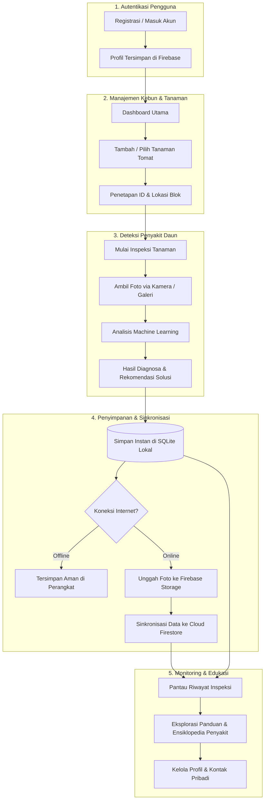
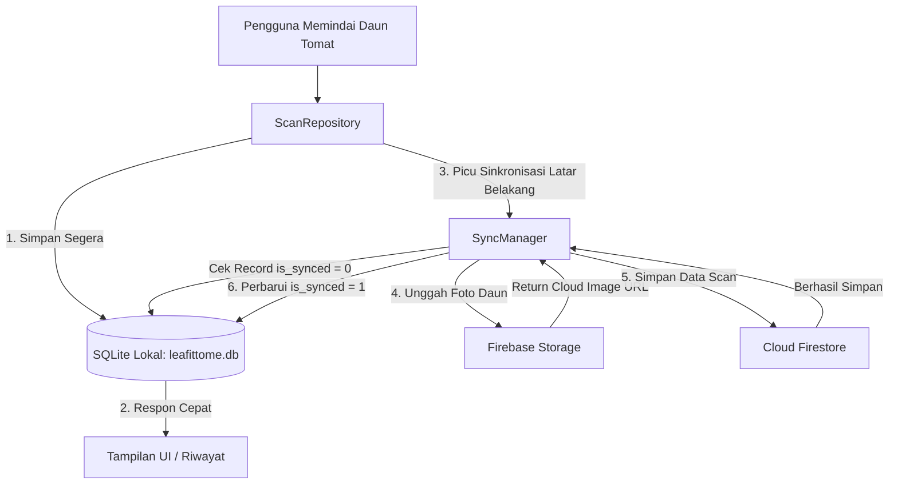

# 🌿 LeafItToMe (PBL Kelompok 1)

Aplikasi deteksi penyakit pada daun tanaman tomat berbasis **Flutter** dan **Machine Learning**, dirancang dengan arsitektur **Offline-First** untuk memastikan petani atau pengguna tetap dapat melakukan pemindaian dan mencatat riwayat penyakit daun tomat bahkan saat berada di area tanpa koneksi internet.

---

## 📱 Alur Penggunaan Aplikasi (User Journey & Workflow)

Bagi pengguna, petani, maupun pengunjung repositori, berikut adalah alur utama penggunaan aplikasi **LeafItToMe** dari awal registrasi hingga pemantauan tanaman:



### Tahapan Penggunaan Aplikasi:

1. **Autentikasi & Registrasi Akun**
   - **Pendaftaran Akun Baru**: Pengguna baru mendaftar di halaman pendaftaran dengan menginputkan **Nama Lengkap**, **Email**, dan **Kata Sandi**.
   - Nama lengkap langsung tersimpan ke profil `displayName` Firebase Auth dan disinkronkan ke dokumen profil di Cloud Firestore.
   - **Masuk Akun (Login)**: Pengguna yang telah memiliki akun dapat langsung masuk dengan email & kata sandi (tersedia fitur pemulihan kata sandi jika lupa).

2. **Dashboard & Manajemen Tanaman Tomat**
   - Setelah masuk, pengguna disajikan ringkasan kesehatan kebun tomat pada **Dashboard Utama**.
   - Pada menu **Tanaman** (*Plants*), pengguna dapat:
     - Mendaftarkan tanaman tomat baru (format ID otomatis seperti `TMT-001`, varietas, dan blok lokasi lahan).
     - Memantau kondisi kesehatan terkini serta riwayat inspeksi dari masing-masing tanaman.

3. **Inspeksi & Deteksi Penyakit Daun (Machine Learning)**
   - Pilih tanaman tomat yang ingin diperiksa, lalu buka menu **Inspeksi**.
   - Ambil foto daun tomat yang menunjukkan gejala penyakit melalui **Kamera** secara langsung atau unggah dari **Galeri**.
   - Model cerdas Machine Learning memproses gambar daun dan menghasilkan:
     - **Nama Diagnosa Penyakit** (atau status Daun Sehat).
     - **Tingkat Keyakinan (*Confidence Level*)**.
     - **Rekomendasi Penanganan & Pengobatan**: panduan langkah praktis untuk mengendalikan hama/penyakit yang terdeteksi.

4. **Penyimpanan Offline-First & Auto-Sync ke Cloud**
   - **Offline-Ready**: Hasil pemindaian langsung tersimpan seketika ke basis data lokal **SQLite** perangkat (`leafittome.db`), sehingga petani di kebun yang minim sinyal tetap dapat bekerja tanpa kendala jaringan.
   - **Auto-Sync**: Saat perangkat mendeteksi koneksi internet, *SyncManager* di latar belakang otomatis mengunggah foto daun ke **Firebase Storage** dan menyinkronkan data inspeksi ke **Cloud Firestore**.

5. **Riwayat Pemantauan (*History*) & Panduan Edukasi (*Guides*)**
   - **Riwayat (*History*)**: Menelusuri seluruh catatan pemindaian sebelumnya, lengkap dengan filter status, tanggal, dan riwayat penanganan.
   - **Panduan Perawatan (*Guides*)**: Ensiklopedia terstruktur mengenai berbagai penyakit daun tomat, gejala visual, tips pencegahan, dan rekomendasi sarana pertanian.
   - **Informasi Pribadi & Profil**: Mengelola data nama lengkap, email, serta nomor kontak telepon yang tersimpan di Cloud Firestore melalui menu *Edit Profil*.

---

## 📌 Ringkasan Pembaruan Backend (Offline-First Sync)

Pembaruan backend terbaru mengimplementasikan arsitektur data **Offline-First Synchronization** yang menggabungkan basis data lokal (**SQLite**) dengan layanan komputasi awan (**Firebase Suite: Auth, Firestore, Storage**).

### 🔄 Alur Kerja Data (Workflow)



1. **Simpan Cepat di Lokal (SQLite)**: Hasil deteksi disimpan terlebih dahulu ke dalam database lokal SQLite perangkat (`leafittome.db`). Hal ini menjamin aplikasi tetap responsif tanpa jeda waktu *network latency* dan tidak pernah gagal akibat kehilangan sinyal.
2. **Sinkronisasi Latar Belakang (SyncManager)**: Secara otomatis mendeteksi record yang belum tersinkron (`is_synced == 0`).
3. **Upload Aset Gambar (Firebase Storage)**: Gambar daun tomat diunggah ke *cloud storage* pada path `scans/{userId}/{scanId}.jpg`.
4. **Penyimpanan Dokumen Cloud (Firestore)**: Metadata hasil scan (nama penyakit, tingkat akurasi/confidence, tanggal, URL gambar, catatan) disimpan pada dokumen `users/{userId}/scans/{scanId}`.
5. **Update Status Sinkron**: SQLite lokal diperbarui menandai record telah tersinkron (`is_synced = 1`) beserta URL gambar dari cloud.

---

## 📁 Struktur Komponen Backend yang Ditambahkan

Berikut adalah file-file backend baru yang berada di dalam folder `mobile_app/lib/`:

| Path File | Komponen / Peran | Deskripsi Fungsi |
|---|---|---|
| `mobile_app/lib/data/models/scan_record_model.dart` | **Data Model** | Model data `ScanRecordModel` dengan dukungan serialisasi dua arah: SQLite (`toSqliteMap`, `fromSqliteMap`) dan Firestore (`toFirestore`). |
| `mobile_app/lib/data/datasources/local/app_database.dart` | **Local Data Source (SQLite)** | Singleton database helper (`AppDatabase`) untuk tabel `scan_history`. Menyediakan fungsi CRUD lokal: simpan hasil scan, ambil riwayat pengguna, dan filter scan yang belum disinkronisasi. |
| `mobile_app/lib/data/datasources/remote/firebase_auth_source.dart` | **Remote Data Source (Auth)** | Pengelola sesi dan autentikasi pengguna menggunakan **Firebase Authentication** (`signIn`, `signUp`, `signOut`, `currentUser`, dan stream `authStateChanges`). |
| `mobile_app/lib/data/datasources/remote/firebase_storage_source.dart` | **Remote Data Source (Storage)** | Pengelola pengunggahan file gambar daun dari direktori lokal ke **Firebase Cloud Storage**. |
| `mobile_app/lib/data/datasources/remote/firestore_scan_source.dart` | **Remote Data Source (Firestore)** | Pengelola penyimpanan data pemindaian terstruktur ke koleksi NoSQL **Cloud Firestore**. |
| `mobile_app/lib/core/sync/sync_manager.dart` | **Sync Engine** | Kelas orkestrasi yang menyatukan SQLite, Storage, dan Firestore untuk menyinkronkan data offline ke cloud secara otomatis. |
| `mobile_app/lib/data/repositories/scan_repository.dart` | **Repository Layer** | *Single source of truth* untuk UI/fitur: menyimpan scan baru, mengambil riwayat scan lokal, dan memicu manual trigger sinkronisasi. |

---

## 📦 Penambahan Dependencies (`pubspec.yaml`)

Dependensi berikut telah ditambahkan ke dalam file [mobile_app/pubspec.yaml](file:///d:/Semester%205/PBL/PBL_Kelompok1_LeafItToMe/mobile_app/pubspec.yaml):

```yaml
dependencies:
  # Penyimpanan & Basis Data Lokal
  sqflite: ^2.4.5          # Mesin basis data SQLite untuk Flutter
  path: ^1.9.1             # Utilitas manajemen path file & basis data

  # Layanan Cloud Backend (Firebase)
  firebase_core: ^5.1.0    # Inisialisasi utama Firebase SDK
  firebase_auth: ^7.0.1    # Autentikasi pengguna (email/password & token)
  cloud_firestore: ^7.1.0  # Basis data NoSQL Cloud Firestore
  firebase_storage: ^14.0.1# Cloud Storage untuk upload foto daun

  # Utilitas
  uuid: ^4.6.0             # Pembuat ID unik universal untuk tiap record scan
```

---

## 🚀 Panduan Instalasi & Persiapan Lingkungan

Bagi anggota tim atau kontributor lain yang ingin mencoba atau mengembangkan backend ini, ikuti langkah-langkah berikut:

### 1. Prasyarat Sistem
- **Git** telah terinstal
- **Flutter SDK** versi 3.x ke atas (dengan Dart 3.x)
  Periksa versi dengan:
  ```bash
  flutter --version
  ```
- **Android Studio** atau **VS Code** (dengan ekstensi Flutter & Dart terpasang)

### 2. Mengambil Kode Sumber
```bash
git clone https://github.com/Indhirayc/PBL_Kelompok1_LeafItToMe.git
cd PBL_Kelompok1_LeafItToMe
git checkout features
```

### 3. Mengunduh & Memasang Dependensi
Masuk ke direktori `mobile_app` lalu jalankan perintah `pub get`:
```bash
cd mobile_app
flutter pub get
```

---

## 🧪 Cara Melakukan Percobaan & Pengujian Backend

### Opsi A: Menjalankan Automated Unit Tests (Tanpa Perlu Setup Firebase)
Semua logika model dan serialisasi backend dapat diuji secara otomatis melalui test runner Flutter:

1. **Uji Khusus Komponen Model & Serialisasi Backend**:
   ```bash
   flutter test test/data/models/scan_record_model_test.dart
   ```
2. **Uji Seluruh Test Suite Proyek**:
   ```bash
   flutter test
   ```
3. **Pemeriksaan Analisis Kode (Linter)**:
   ```bash
   flutter analyze lib/data lib/core/sync
   ```

### Opsi B: Contoh Penggunaan `ScanRepository` dalam Kode
Untuk mencoba alur kerja penyimpanan data pemindaian daun dalam aplikasi:

```dart
import 'package:mobile_app/data/models/scan_record_model.dart';
import 'package:mobile_app/data/repositories/scan_repository.dart';
import 'package:uuid/uuid.dart';

void main() async {
  // 1. Inisialisasi Repository
  final scanRepository = ScanRepository();

  // 2. Buat data hasil deteksi (dummy data percobaan)
  final recordBaru = ScanRecordModel(
    id: const Uuid().v4(),
    userId: 'user-demo-123',
    diseaseName: 'Tomato Early Blight',
    confidence: 0.94,
    localImagePath: '/path/to/local/daun_tomat.jpg',
    scannedAt: DateTime.now(),
    isSynced: false,
  );

  // 3. Simpan data (langsung tersimpan ke SQLite lokal & memicu auto-sync)
  await scanRepository.saveScanResult(recordBaru);

  // 4. Ambil seluruh riwayat scan pengguna dari SQLite lokal
  final riwayat = await scanRepository.getUserHistory('user-demo-123');
  for (final scan in riwayat) {
    print('ID: ${scan.id} | Penyakit: ${scan.diseaseName} | Status Sinkron: ${scan.isSynced}');
  }

  // 5. Memicu sinkronisasi manual saat perangkat kembali online
  await scanRepository.triggerSync('user-demo-123');
}
```

---

## ⚙️ Konfigurasi Firebase (Untuk Percobaan Live Cloud)

Jika ingin menjalankan aplikasi secara penuh dengan sinkronisasi ke Firebase Console:

1. **Buat Proyek di [Firebase Console](https://console.firebase.google.com/)**:
   - Buat project baru bernama `LeafItToMe`.
   - Aktifkan **Authentication** dengan metode *Email/Password*.
   - Aktifkan **Cloud Firestore** dalam mode *Test Mode* (atau sesuai aturan keamanan tim).
   - Aktifkan **Firebase Storage**.

2. **Hubungkan dengan FlutterFire CLI**:
   Pasang CLI jika belum ada:
   ```bash
   dart pub global activate flutterfire_cli
   ```
   Jalankan konfigurasi otomatis di dalam folder `mobile_app`:
   ```bash
   flutterfire configure
   ```
   *Atau letakkan file `google-services.json` yang diunduh dari Firebase Console ke dalam folder `mobile_app/android/app/`.*

3. **Inisialisasi pada `main.dart`**:
   Pastikan Firebase diinisialisasi sebelum menjalankan aplikasi:
   ```dart
   void main() async {
     WidgetsFlutterBinding.ensureInitialized();
     await Firebase.initializeApp();
     runApp(const MyApp());
   }
   ```

---

## 🌳 Struktur Direktori Proyek

```text
PBL_Kelompok1_LeafItToMe/
├── README.md                           # Dokumentasi utama proyek
├── mobile_app/
│   ├── pubspec.yaml                    # Konfigurasi dependensi Flutter & Firebase
│   ├── lib/
│   │   ├── app/                        # Konfigurasi rute dan tema aplikasi
│   │   ├── core/                       # Utilitas, network, dan sinkronisasi
│   │   │   ├── network/                # ApiClient & konfigurasi REST API
│   │   │   └── sync/
│   │   │       └── sync_manager.dart   # Service sinkronisasi Offline-to-Cloud
│   │   ├── data/                       # Lapisan data backend aplikasi
│   │   │   ├── datasources/
│   │   │   │   ├── local/
│   │   │   │   │   └── app_database.dart          # SQLite Database (sqflite)
│   │   │   │   └── remote/
│   │   │   │       ├── firebase_auth_source.dart  # Firebase Authentication
│   │   │   │       ├── firebase_storage_source.dart # Firebase Storage
│   │   │   │       └── firestore_scan_source.dart # Cloud Firestore
│   │   │   ├── models/
│   │   │   │   └── scan_record_model.dart         # Model Scan Record
│   │   │   └── repositories/
│   │   │       └── scan_repository.dart           # Scan Repository pattern
│   │   └── features/                   # Modul UI aplikasi (auth, detection, guide, history, plants)
│   └── test/                           # Automated unit test & widget test
```

---

## 👥 Tim Pengembang (PBL Kelompok 1)
- **LeafItToMe Team** - Aplikasi Deteksi Penyakit Daun Tanaman Tomat
